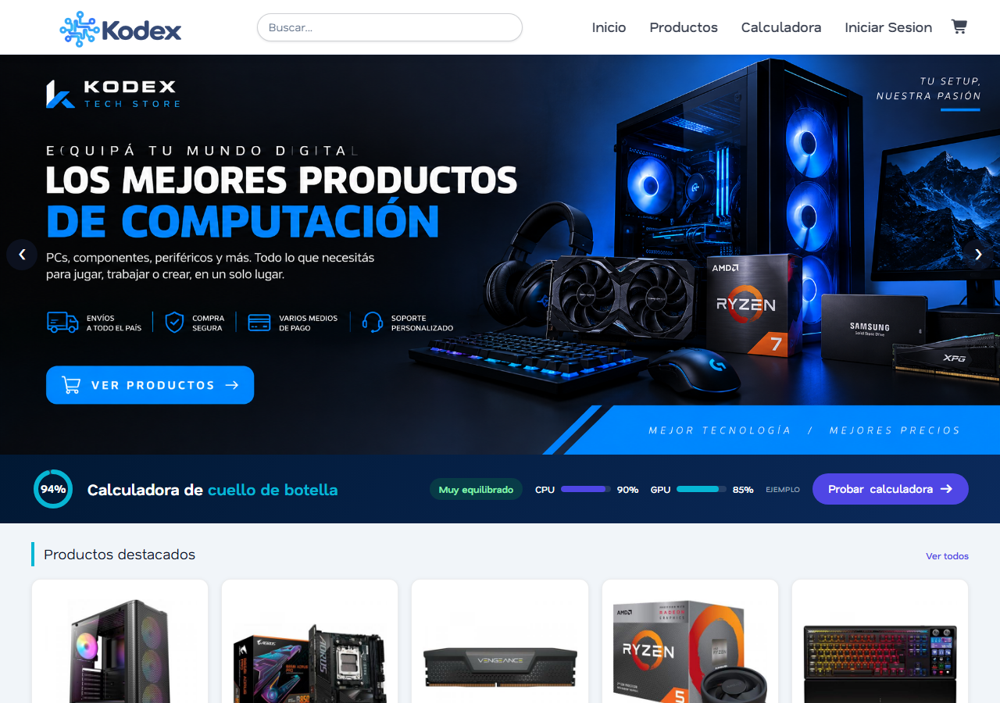
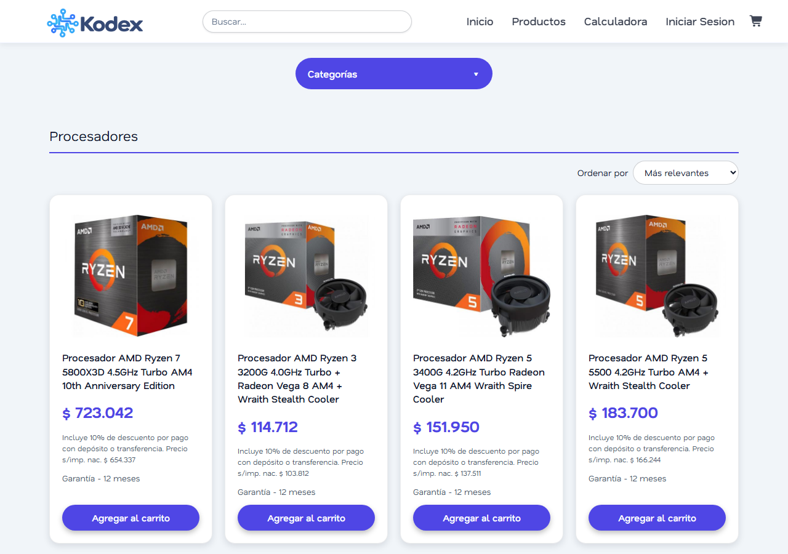
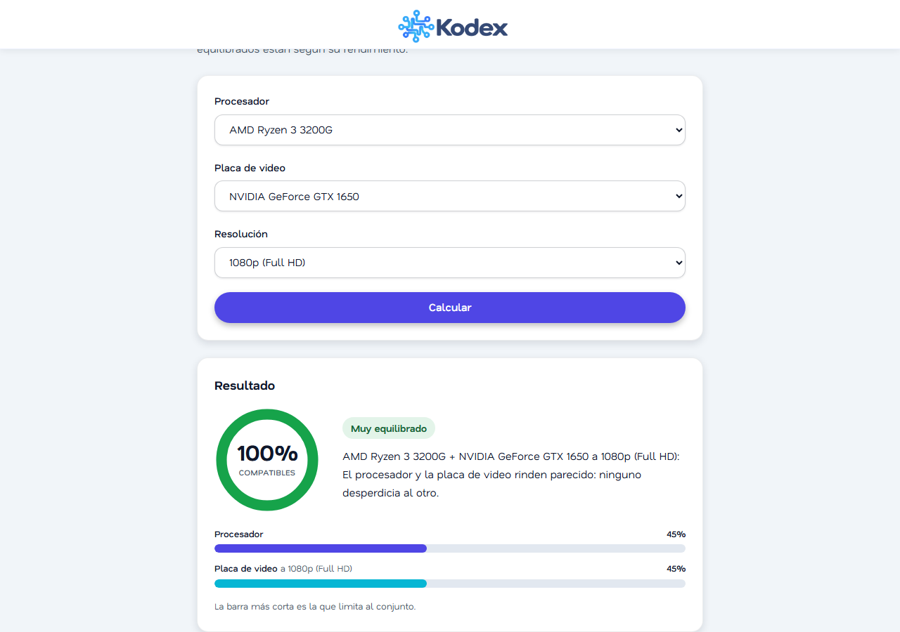
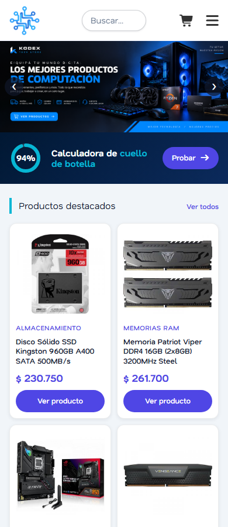

# Kodex Tech Store

[](https://github.com/diegopereyrasilvetti/E-commerce/actions/workflows/ci.yml)

Tienda online de hardware de PC (procesadores, placas de video, memorias, almacenamiento y más) hecha con **React, Vite y Tailwind CSS**. Es una aplicación de una sola página (SPA): un único `index.html` y las pantallas como componentes.



## Qué se puede hacer

- **Inicio:** carrusel de promociones que cambia solo cada 4 segundos, banner de la calculadora, productos destacados al azar que se renuevan cada 8 segundos y acceso por categoría.
- **Productos:** las 10 categorías, cada una con su lista y orden por menor o mayor precio. Al tocar un producto se abre una ventana con la imagen, los precios, el descuento y la garantía.
- **Buscador:** en el header, sugiere productos mientras se escribe (sin importar tildes ni mayúsculas, por nombre o categoría) y al elegir uno abre su categoría con el detalle abierto. El enlace se puede compartir (`/productos/mothers?producto=...`) y funciona con el teclado.
- **Carrito:** agregar, cambiar cantidades, quitar y vaciar. Muestra subtotal, descuento por transferencia, total y cuotas sin interés (1, 6, 12 o 18). Se guarda en el navegador y sigue ahí al recargar.
- **Calculadora de cuello de botella:** compara un procesador y una placa de video según la resolución, con un gráfico circular del porcentaje de compatibilidad.
- **Cuentas de usuario (Supabase Auth):** registro con confirmación por email, inicio y cierre de sesión, recuperación de contraseña por correo y sesión que se mantiene al recargar. Los formularios tienen validación propia (email, contraseña de al menos 8 caracteres con letra y número, confirmación, términos) y mensajes de error por campo. `/carrito` y `/cuenta` solo se abren con sesión, y sin usuario "Agregar al carrito" lleva a iniciar sesión.
- **Mi cuenta (PostgreSQL):** el usuario edita su perfil y administra sus direcciones de envío (alta, edición, baja y dirección principal), guardadas en la base de datos. Cada usuario solo puede ver y modificar sus propios datos gracias a las políticas RLS.
- **Responsive y accesible:** pensado para celular, tablet y escritorio; navegable con teclado y con respeto a `prefers-reduced-motion`.

| Categoría | Calculadora | Celular |
|---|---|---|
|  |  |  |

## Tecnologías

- [React 19](https://react.dev) con hooks (`useState`, `useEffect`, `useReducer`, `useContext`, `useMemo`)
- [React Router 7](https://reactrouter.com) para las rutas
- [Vite 8](https://vite.dev) como herramienta de desarrollo y compilación
- [Tailwind CSS 4](https://tailwindcss.com) con la paleta del sitio definida en `src/index.css`
- [Supabase](https://supabase.com): Auth para las cuentas y PostgreSQL para perfiles, direcciones y catálogo
- [Node.js](https://nodejs.org) + [Express 5](https://expressjs.com) para la API REST, con [Zod](https://zod.dev) (validación), Helmet, CORS y límite de solicitudes (seguridad)
- Font Awesome para los íconos

## Cómo correrlo

Requiere [Node.js](https://nodejs.org) 20 o más nuevo.

```bash
npm install     # una sola vez
npm run dev     # desarrollo en http://localhost:5173
npm run build   # genera la carpeta dist/ para publicar
npm run preview # prueba el build local
```

### Pruebas

```bash
npm test                       # frontend: validaciones, dinero y búsqueda (40 pruebas)
npm --prefix server test       # servidor: API completa (142 pruebas)
npm --prefix server run coverage   # lo mismo, con el porcentaje de código cubierto
```

Las pruebas del servidor levantan la API real con datos en memoria y usuarios simulados (Vitest + Supertest), así que no necesitan claves ni conexión a Supabase. Cubren el catálogo público, los permisos (sin sesión, cliente y administrador), las validaciones, los pedidos (cuentas, privacidad entre usuarios y estados), las cabeceras de seguridad, CORS y los límites de solicitudes, además de la lógica de acceso a la base con un cliente de Supabase simulado. Cobertura del servidor: ~99 % de las líneas. GitHub Actions las corre en cada push (`.github/workflows/ci.yml`).

Además, las reglas de seguridad de la base (RLS, permisos por columna, transacciones y restricciones) se verificaron contra una base real de Supabase con usuarios temporales.

### API (carpeta `server/`)

El catálogo de productos sale de una API propia que lee de PostgreSQL. Para correrla:

```bash
npm --prefix server install                # una sola vez
# copiá server/.env.example como server/.env y completalo (ver abajo)
npm --prefix server run cargar-productos   # carga los productos en la base (una sola vez, o para actualizarlos)
npm --prefix server run dev                # API en http://localhost:3001
npm run dev                                # el sitio (en otra terminal); Vite redirige /api al servidor
```

| Método | Ruta | Qué hace |
|---|---|---|
| GET | `/api/salud` | Comprueba que el servidor está andando |
| GET | `/api/categorias` | Lista las categorías |
| GET | `/api/productos` | Lista productos. Parámetros: `categoria`, `q` (búsqueda), `orden` (`relevancia`, `precio_asc`, `precio_desc`), `pagina`, `limite` (máx. 100) |
| GET | `/api/productos/:slug` | Un producto |
| GET | `/api/yo` | **Con sesión.** Quién soy según el servidor: `id`, `email` y `rol` |
| POST | `/api/productos` | **Solo admin.** Crea un producto |
| PATCH | `/api/productos/:slug` | **Solo admin.** Modifica los campos enviados |
| DELETE | `/api/productos/:slug` | **Solo admin.** Oculta el producto del catálogo (no lo borra de la base) |
| POST | `/api/pedidos` | **Con sesión.** Crea un pedido: `{ items: [{ slug, cantidad }], medioPago, cuotas?, direccionId }` |
| GET | `/api/pedidos` | **Con sesión.** Mis pedidos (con `?todos=true`, un administrador ve los de todos) |
| GET | `/api/pedidos/:id` | **Con sesión.** Un pedido (solo el dueño o un administrador) |
| POST | `/api/pedidos/:id/cancelar` | **Con sesión.** El dueño cancela su pedido mientras esté pendiente |
| PATCH | `/api/pedidos/:id/estado` | **Solo admin.** Pasa el pedido al siguiente estado |

**Pedidos:** el navegador solo manda qué productos quiere, en qué cantidad, el medio de pago, las cuotas y el id de una dirección suya. Los precios, el descuento por transferencia, el total y el valor de la cuota **los calcula el servidor** con los precios de la base, y la dirección se copia al pedido (si después se edita o se borra, el pedido conserva a dónde se mandó). Cada usuario solo ve y cancela sus pedidos; consultar el de otro responde 404. Estados: `pendiente → pagado → enviado → entregado` (o `cancelado`). Mientras `PEDIDOS_HABILITADOS` sea `false` (por defecto), la API responde 503: el sitio es de demostración y no realiza ventas.

**Autenticación y roles:** las rutas protegidas piden la cabecera `Authorization: Bearer <token>` con el token de sesión de Supabase. El servidor no confía en el cliente: le pregunta a Supabase si el token es válido y lee el rol (`cliente` o `admin`) de la tabla `perfiles`. Sin sesión responde 401; con sesión pero sin permiso, 403. Las escrituras tienen además un límite de 60 por IP cada 15 minutos.

Las respuestas de error tienen siempre la forma `{ "error": { "codigo", "mensaje", "detalles?" } }`. Seguridad: todo dato de entrada se valida con Zod, cabeceras seguras con Helmet, CORS limitado a los sitios configurados, 300 solicitudes cada 15 minutos por IP y el cuerpo de las solicitudes limitado a 10 KB. El servidor usa la clave *secret* de Supabase (solo en `server/.env`), que se salta las reglas RLS, por eso las reglas de acceso se programan en la API.

### Base de datos

Las migraciones (SQL) están en `supabase/migrations/` y se ejecutan en orden en el *SQL Editor* de Supabase:

1. `001_perfiles_y_direcciones.sql`: tablas `perfiles` y `direcciones`, sus políticas de seguridad (RLS) y el trigger que crea el perfil al registrarse.
2. `002_catalogo.sql`: tablas `categorias` y `productos`. No tienen políticas: solo la API (clave secret) puede leerlas.
3. `003_roles.sql`: columna `rol` en `perfiles`. Los usuarios no pueden cambiarse el rol a sí mismos (se les quita el permiso de escribir esa columna). Para hacer administrador a alguien se ejecuta un `update` a mano en el SQL Editor (está explicado en el archivo).
4. `004_pedidos.sql`: tablas `pedidos` y `pedido_items` (con la dirección y los precios copiados al momento de comprar) y la función `crear_pedido`, que guarda el pedido y sus renglones en una sola transacción. Solo la API puede usarlas.

### Variables de entorno

Copiá `.env.example` como `.env.local` y completá la URL y la clave pública (*publishable*) de tu proyecto de Supabase (*Project Settings → API Keys*). Nunca uses la clave *secret* en el frontend. `.env.local` no se sube a git.

En Supabase (*Authentication → URL Configuration*) hay que poner la **Site URL** (por ejemplo `http://localhost:5173`) y agregar la dirección del sitio en **Redirect URLs** (`http://localhost:5173/**`); si no, los enlaces de los correos (confirmar cuenta y recuperar contraseña) no vuelven al sitio.

## Publicación

El proyecto se publica en dos partes:

| Parte | Dónde | Configuración |
|---|---|---|
| Sitio (React) | [Vercel](https://vercel.com) | `vercel.json` redirige todas las direcciones a `index.html` (así funcionan `/productos/mothers` o `/carrito` al recargar) |
| API (Express) | [Render](https://render.com) | `render.yaml` (servicio web con la carpeta `server/` como raíz) |
| Base de datos y cuentas | [Supabase](https://supabase.com) | migraciones en `supabase/migrations/` |

**Variables de entorno en Vercel** (*Settings → Environment Variables*, en Production y Preview):
- `VITE_SUPABASE_URL` y `VITE_SUPABASE_ANON_KEY`: la URL y la clave pública (*publishable*) de Supabase.
- `VITE_API_URL`: la dirección de la API en Render, sin barra al final (por ejemplo `https://kodex-api.onrender.com`).

**Variables de entorno en Render** (*Environment* del servicio):
- `SUPABASE_URL` y `SUPABASE_SECRET_KEY`: la URL y la clave *secret* (solo se carga en el servidor).
- `CORS_ORIGINS`: las direcciones del sitio que pueden usar la API, separadas por coma (por ejemplo `https://ecommerce-chi-hazel.vercel.app`).
- `PEDIDOS_HABILITADOS`: `false` mientras el sitio sea de demostración.

El plan gratuito de Render duerme el servidor tras 15 minutos sin uso: la primera visita después de un rato puede tardar entre 30 y 60 segundos (el sitio muestra "Cargando productos…" mientras tanto).

## Estructura

```
index.html              Único HTML de la aplicación
public/images/          Imágenes de productos y promociones (se sirven en /images/...)
src/                    Frontend (React)
  main.jsx              Punto de entrada: Router y proveedores (sesión, catálogo, carrito)
  App.jsx               Rutas
  index.css             Tailwind, paleta de colores y cortes de pantalla
  auth.jsx              Sesión con Supabase: AuthProvider y hook useAuth
  catalogo.jsx          Catálogo traído de la API: CatalogoProvider y hook useCatalogo
  cart.jsx              Carrito: estado, hook useCart, botón, globito y página /carrito
  layouts/Layout.jsx    Header + página + footer
  pages/                Inicio, Productos, Calculadora, Login, Registro, RecuperarPassword, NuevaPassword, Cuenta, NoEncontrada
  components/           Header, Footer, Carrusel, Destacados, ProductoCard, ProductoDetalle, CampoFormulario, RutaProtegida, MenuUsuario, CarritoVacio, CategoriasRapidas, FormularioDireccion, BuscadorProductos
  lib/                  supabase.js (cliente), api.js (cliente de la API), cuenta.js (perfil y direcciones)
  data/                 Categorías y datos de la calculadora
  utils/                Dinero, validaciones, búsqueda de productos, hook useFormulario, título de la pestaña
server/                 API REST (Node.js + Express)
  src/app.js            Arma la aplicación: seguridad y rutas
  src/index.js          Arranque: lee la configuración y conecta con Supabase
  src/auth.js           Verifica el token de Supabase y obtiene el rol del usuario
  src/pedidos/          Cuentas de un pedido (totales, descuento y cuotas)
  src/routes/           Rutas: salud, yo, categorías, productos, pedidos
  src/repositorios/     Acceso a la base de datos (Supabase)
  src/middleware/       Sesión y roles, manejo de errores
  seed/                 Productos de partida y su conversión a filas de la base
  scripts/              Carga de productos en la base
  test/                 Pruebas automáticas, repositorio en memoria y servidor de prueba (sin base de datos)
supabase/migrations/    Esquema de la base de datos (SQL)
```

## Decisiones de diseño

- **Un solo estado del carrito para toda la app.** `CartProvider` usa `useReducer` y comparte el carrito por contexto; cualquier componente lo lee con `useCart()`. Los totales se calculan a partir de los productos, no se guardan.
- **Los productos son datos, no HTML.** Para agregar uno se suma a la base de datos (o a `server/seed/productos.js` y se corre `npm --prefix server run cargar-productos`) y aparece solo en su categoría, en los destacados y en el detalle.
- **Rutas con la categoría en la dirección** (`/productos/:categoria`): se puede compartir el enlace de una categoría y funcionan los botones de atrás y adelante.
- **Sin dependencias de más:** el carrusel, la ventana de detalle (`<dialog>`), el gráfico circular (SVG) y el cálculo son código propio.

## Qué falta (a propósito)

- **No hay ventas:** "Finalizar compra" está desactivado y el footer aclara que es un proyecto de portfolio. Se activa con `COMPRAS_HABILITADAS` en `src/config.js`, cuando exista un medio de pago y un backend de pedidos.
- **Los productos están en un archivo.** La próxima etapa es una API propia con Node.js y Express para productos, usuarios y pedidos.
- El índice de rendimiento de la calculadora es una estimación orientativa, no mediciones reales.

## Datos del carrito

El carrito se guarda en `localStorage` con la clave `kodex-carrito`; la sesión la guarda y renueva Supabase. Un producto se identifica por su `imagen` porque el nombre se puede repetir.
